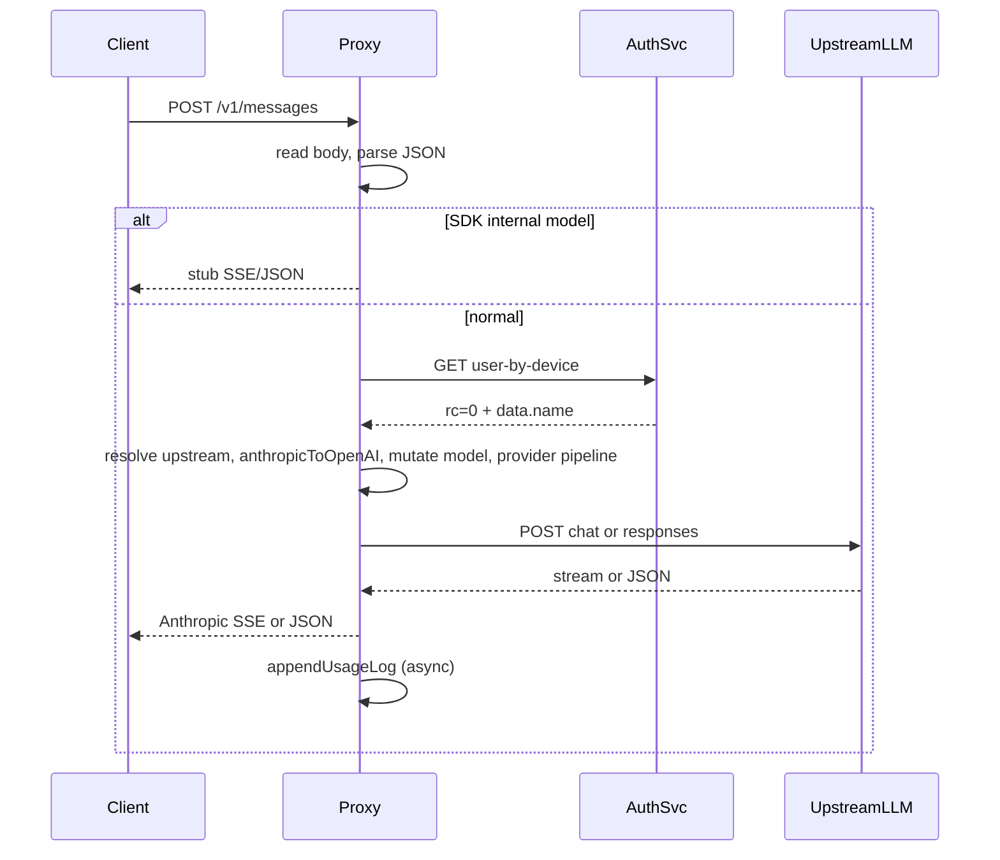

# WoiClaw Proxy 详细设计文档（面向开发与 Vibe Coding）

**目的**：本文档与源码一一对应，使开发人员在不全读三千行 `proxy.ts` 的情况下，仍能**安全地改逻辑、加厂商适配、排障**。  
**配套**：`README.md`（运维与配置）、`docs/PRD-WoiClaw-Proxy.md`（需求与范围）、`docs/es-usage-index.md`（ES 字段）。  
**约定**：文中「SHALL/MUST」表示与当前实现一致的行为约束；「建议」表示工程经验。

---

## 1. 推荐阅读顺序（Vibe Coding 路线）

| 步骤 | 读什么 | 目的 |
|------|--------|------|
| 1 | 本文第 2–4 节 + `src/index.ts` | 进程如何起、配置如何进内存 |
| 2 | 本文第 5–7 节 + `src/config.ts` | 上游如何选、model 字符串语义 |
| 3 | 本文第 8–10 节 + `formatTransform.ts` 中 `anthropicToOpenAI` / `openAIToAnthropic` | 协议转换边界 |
| 4 | 本文第 11–14 节 + `proxy.ts` 中 `handleRequest` 尾部（从 `anthropicToOpenAI` 到 `fetch`） | 请求变形顺序**极易写反** |
| 5 | 本文第 15–17 节 + `proxy.ts` 中 `handleChatCompletionsStreamResponse` / `processOpenAIChunk` | 流式状态机 |
| 6 | `src/codePlanPool.ts` + `src/codePlanQuota.ts` | 多 key 池与冷却 |
| 7 | `src/usageLogger.ts` + `appendUsageLog` 调用点 | 用量字段从哪来 |

改 bug 时：先用 **reqId**（`handleRequest` 里生成）在 verbose 日志中串请求；再确认 **upstreamAPIType**（`chat_completions` vs `responses`）。

---

## 2. 仓库结构（模块职责）

```
woiClaw-proxy/
├── src/
│   ├── index.ts              # 入口：loadConfig、Pool、createProxyServer、fs.watch 热加载
│   ├── proxy.ts              # HTTP 服务、鉴权、上游 fetch、流式状态机、usage 上下文（主体）
│   ├── config.ts             # JSON/env 配置解析、resolveUpstreamFromModel、校验 Code Plan
│   ├── formatTransform.ts    # anthropicToOpenAI、openAIToAnthropic、URL 拼接、Schema 清洗
│   ├── codePlanPool.ts       # 轮询选 key、冷却 Map、reconcileFromConfig
│   ├── codePlanQuota.ts      # isQuotaLimitedResponse（429 + 文案启发式）
│   ├── usageLogger.ts        # JSONL 异步写入、按天/大小滚动
│   ├── logger.ts             # 控制台 + proxy-*.log，VERBOSE 门控
│   └── scripts/
│       └── sync-usage-to-es.ts  # 增量 bulk ES（独立进程）
├── proxy-config.json         # 运行时配置（可挂载只读）
├── Dockerfile / docker-compose.yml
└── docs/
```

**依赖关系（单向）**：

- `index` → `config`, `codePlanPool`, `proxy`, `logger`
- `proxy` → `formatTransform`, `config`（仅 `resolveUpstreamFromModel` 类型/函数）, `codePlanPool`, `codePlanQuota`, `usageLogger`, `logger`
- `formatTransform` 不依赖 `proxy`（保持可单测）

---

## 3. 运行时上下文（必须理解的全局对象）

### 3.1 `ProxyRuntimeContext`（`proxy.ts`）

```ts
export type ProxyRuntimeContext = {
  upstreamsByIdMap: Map<string, UpstreamConfig>;
  defaultUpstream: UpstreamConfig | undefined;
};
```

- **可变**：热加载时整表替换 `ctx.upstreamsByIdMap` 与 `ctx.defaultUpstream`（见 `index.ts` `reloadConfigFromDisk`）。
- **无线程锁**：Node 单线程；并发请求读同一快照即可。

### 3.2 `CodePlanPoolManager`（每进程一个实例）

- `pickOrFallback(upstreamKey, upstream)`：`upstreamKey` 为 `upstreamsById` 的 **id**，默认上游为 `'__default__'`。
- 冷却 key 为 `` `${upstreamKey}\0${credentialId}` ``，避免不同上游同名 id 冲突。

### 3.3 模块级 `toolCallExtraContentById`（`proxy.ts`）

- `Map<string, unknown>`，用于 **Gemini 等**在下一轮请求把 `extra_content` 填回 `tool_calls`。
- **容量**：`MAX_TOOL_CALL_EXTRA_CONTENT_CACHE = 1024`，超出时 `cacheToolCallExtraContent` 内用 `Map` 删除最老条目（需读源码确认策略）。
- **生命周期**：进程级；多实例不共享。

---

## 4. 启动与配置热加载

### 4.1 启动流程（`index.ts`）

1. `loadConfig(configPathArg)`：读文件或 env 单上游模式。
2. `new CodePlanPoolManager()`，`pool.reconcileFromConfig(config)`。
3. `buildUpstreamsByIdMap(config)` → `ctx`。
4. `createProxyServer(ctx, pool)`，`listen(port, host)`。
5. 若磁盘存在 `proxy-config.json`：`fs.watch` → **300ms debounce** → `parseProxyConfigObject` → 更新 `ctx` + `pool.reconcileFromConfig`。

### 4.2 热加载失败行为

- `parse` 或 `validateCodePlanUpstreams` 抛错 → **保留旧配置**，打 `logger.error`。

### 4.3 开发人员注意

- 新增 `UpstreamConfig` 字段时：必须同时改 `normalizeUpstream`（`config.ts`）、必要时 `validateCodePlanUpstreams`，并在 `proxy.ts` 里消费。
- 热加载**不会**重启 HTTP server，**不会**改 `listen` 端口（`port` 变更需重启进程）。

---

## 5. HTTP 路由与处理分支（决策树）

```
请求进入 createProxyServer
│
├─ GET  /healthz                    → 200 { ok: true }
├─ POST /v1/messages/count_tokens   → 200 { input_tokens: 0 }，消费 body
├─ POST /api/event_logging/batch    → 204，消费 body
├─ POST /v1/messages                → 主逻辑（见第 7 节）
└─ 其他                              → 404 Anthropic error not_found_error
```

主路径之前：**无**全局中间件；**无**请求 ID 中间件（reqId 仅在 `/v1/messages` 内生成）。

---

## 6. `POST /v1/messages` 主路径分阶段说明

下列顺序与 `handleRequest` 源码一致，**调整顺序前必须理解副作用**。

| 阶段 | 行为 | 失败时 |
|------|------|--------|
| A | `readRequestBody` | 400，`invalid_request_error` |
| B | `JSON.parse` | 400 |
| C | `isClaudeAgentSdkInternalModel(model)` | true → `sendSdkInternalStubResponse`，**结束**（不鉴权） |
| D | `extractClientApiKey` 空 | 401 `authentication_error` |
| E | `fetchUserInfo` | 401 |
| F | `resolveUpstreamFromModel` null | 403 `permission_error` |
| G | Code Plan `pickOrFallback` + 可能改 `baseURL` / `apiKey` | — |
| H | `anthropicToOpenAI` | — |
| I | 覆盖/重写 `openAIRequest.model`（内部名、回落 map、ark code plan） | — |
| J | `resolveUpstreamAPIType` → provider 清洗链 | — |
| K | 可能 `convertChatCompletionsRequestToResponsesRequest` | — |
| L | Chat 流式时 `stream_options.include_usage = true` | — |
| M | `fetch` 上游 | 502 / 下游错误处理链 |
| N | 流式 → `handle*StreamResponse`；非流式 → `json()` + `openAIToAnthropic` + `appendUsageLog` | — |

### 6.1 序列图（简化）



---

## 7. 上游解析：`model` 字符串

**实现**：`config.resolveUpstreamFromModel(modelStr, upstreamsByIdMap, defaultUpstream)`。

| model 形式 | 行为 |
|------------|------|
| `upstreamId\|modelId` 且 id 命中 map | 使用该上游，`modelId` 发往上游（空则用该上游默认 model） |
| `upstreamId\|modelId` 且 id 未命中 | 若有 `defaultUpstream`，用 default + `modelId` |
| 无 `\|` 或 `\|` 在首位无效 | 用 `defaultUpstream`，model 为整串或默认 |
| 无 default 且无法解析 | `null` → 403 |

**Code Plan 的 upstreamKey**：`upstreamRouteId ?? '__default__'`（见 `handleRequest`）。

---

## 8. Code Plan 池（实现细节）

### 8.1 配置（`UpstreamConfig`）

- `codePlanCredentials?: { id: string; apiKey: string }[]`
- `codePlanBaseURL?`：仅当本次选中**池内凭证**（`credentialId !== null`）时替换请求用的 `baseURL`。
- `ordinaryFallbackModelMap?`：仅当 **回落普通 key**（`credentialId === null`）且 map 非空时，对当前 `openAIRequest.model` 做 key→value 替换。
- **硬约束**：池非空则必须配置非空普通 `apiKey`（`validateCodePlanUpstreams`）。

### 8.2 选取算法（`CodePlanPoolManager.pickOrFallback`）

1. 过滤掉仍在冷却期内的 credential，得到 `available`。
2. 若 `available` 为空 → 返回 `{ apiKey: upstream.apiKey, credentialId: null }`。
3. 若请求头 **`X-WoiCrew-Session-Id`** 非空（`proxy` 传入 `sessionId`）：`start = sessionIdToCodePlanSlot(sessionId, list.length)`（FNV-1a），从 `list[(start+offset) % list.length]` 依次尝试 `offset=0..len-1`，选第一个仍在 `available` 的项（配置顺序顺延），便于同会话固定到同一 Code Plan key；若极端情况未命中则用 `available[0]`。
4. 若无 session id：round-robin——`roundRobin.get(upstreamKey) ?? 0`，对 `available.length` 取模，然后 `idx + 1` 写回。

Node 会把请求头规范为小写，读取键名 `x-woicrew-session-id`。

### 8.3 冷却触发（`handleRequest` 上游错误分支）

- 条件：`pool` 存在 + 本次 `codePlanCredentialIdForCooldown` 非空 + `!upstreamResponse.ok` + `isQuotaLimitedResponse(status, bodyText)`。
- 动作：`pool.markCooldown(codePlanPoolKey, codePlanCredentialIdForCooldown)`（30 分钟，从**当前时刻**重算）。
- **重要**：同一 HTTP 请求内**不会**换 key 重试；注释中标为 SC-007。

### 8.4 Ark 特例

- 当 `provider === 'ark'`（大小写不敏感比较）且 **选中了池内凭证**（`credentialId !== null`），强制 `openAIRequest.model = 'ark-code-latest'`（常量 `ARK_CODE_PLAN_UPSTREAM_MODEL`）。

---

## 9. Provider 管道：调用顺序（**禁止随意重排**）

下列顺序来自 `handleRequest` 源码（约 2739–2804 行思路）。

1. `anthropicToOpenAI(parsedRequestBody)`  
2. 设置 `openAIRequest.model = modelId`（及缺省补全）  
3. **内部 Claude 名重写**：非 anthropic/openai 的 provider 且 model 像 `claude-*` 或 SDK 内部名 → 可改为 `upstreamForRequest.model`  
4. **ordinaryFallbackModelMap**（仅 `codePlanPickResult.credentialId === null`）  
5. **Ark code plan 固定 model**（仅 ark + 池内凭证）  
6. `upstreamAPIType = resolveUpstreamAPIType(provider)`（**仅** `openai` → responses）  
7. `filterOpenAIToolsForProvider`（去 `skill`）  
8. `remapMessageRolesForMiniMax`（developer→system）  
9. `hydrateOpenAIRequestToolCalls`（缓存 / Gemini 占位签名）  
10. 若 `chat_completions`：`normalizeMaxTokensFieldForOpenAIProvider`  
11. 若 `chat_completions`：`mergeSystemMessagesForProvider`  
12. 若 `responses`：`convertChatCompletionsRequestToResponsesRequest(openAIRequest)`  
13. 若流式且 chat：`stream_options = { include_usage: true }`

**常见事故**：在 `mergeSystemMessages` 之后再做依赖原始 messages 结构的逻辑 → 已合并，需前置。

---

## 10. 上游 URL 与 404 回退

### 10.1 Chat Completions

- **实现**：`formatTransform.buildOpenAIChatCompletionsURL(baseURL)`（处理尾斜杠、`/v1`、Gemini 域名特殊路径）。

### 10.2 Responses

- **实现**：`buildOpenAIResponsesURL(baseURL)`。

### 10.3 `buildUpstreamTargetUrls`

- Responses：单 URL 数组。
- Chat：主 URL + 若 Gemini 则再加 v1beta/v1 互换候选（`Set` 去重）。

### 10.4 404 链式重试

- 仅当 `targetURLs.length > 1` 且首个响应 **404** 时，依次换 URL 重发**同一 payload**（见 `handleRequest`）。

---

## 11. 上游 4xx 自动修复重试（仅 Chat + 400）

在仍非 ok 时，按顺序尝试（每次成功后若仍失败可能继续下一项）：

1. **Tools 不支持**：`isToolsUnsupportedError` → `stripToolsFromRequest` → 重发。  
2. **max_tokens 不支持**：`isMaxTokensUnsupportedError` → `convertMaxTokensToMaxCompletionTokens` → 重发。  
3. **从错误信息解析范围**：`clampMaxTokensFromError` → 重发。

若最终仍失败：可能 **markCooldown**（Code Plan），再以 `upstreamResponse.status` 写 JSON 错误给客户端（`createAnthropicErrorBody`）。

---

## 12. 格式转换：Anthropic → OpenAI（`anthropicToOpenAI`）

**文件**：`formatTransform.ts`

### 12.1 输入假设

- Anthropic Messages body：`system`（string 或 content block 数组）、`messages`、`max_tokens`、`tools`、`tool_choice`、`stream` 等。

### 12.2 关键映射

| Anthropic | OpenAI 请求 |
|-----------|-------------|
| `system` 字符串 | `messages` 前插一条 `{ role:'system', content }` |
| `system` 数组 | 多条 text block → 多条 system 消息 |
| `messages[]` | `convertMessageToOpenAI` 展开（含 tool、多模态，见同文件） |
| 合成图片 tool/user 对 | `retainOnlyLastSyntheticImagePair` 只保留**最后一对**（控制上下文长度） |
| `tools[]` | 过滤 `type==='BatchTool'`，转 `type:function` + `cleanSchema(input_schema)` |
| `tool_choice` | 原样拷贝（后续可能被 `filterOpenAIToolsForProvider` 改写） |
| `stop_sequences` | `stop` |

### 12.3 `cleanSchema`

- 删除 `$schema`、`format: uri` 等易引发兼容问题的字段；递归处理 `properties` / `items`。

**开发扩展点**：新增 Anthropic 字段支持时，在 `anthropicToOpenAI` 或 `convertMessageToOpenAI` 中增加映射，并补一条集成测试（若项目暂无测试，至少手造 JSON 走一遍）。

---

## 13. 格式转换：OpenAI → Anthropic（`openAIToAnthropic`）

用于**非流式**完整响应；输入为 **Chat Completions** 形态的 JSON（含 `choices[0].message`）。

| OpenAI | Anthropic `content[]` |
|--------|----------------------|
| `message.reasoning_content` / `reasoning` | `type: thinking` |
| `message.content` 字符串或 text part 数组 | `type: text` |
| `message.tool_calls[]` | `type: tool_use`，`input` 为解析后的 JSON（失败则 `{}`） |
| `extra_content` / `function.thought_signature` | 写入 `tool_use.extra_content`（Gemini） |
| `usage.prompt_tokens` / `input_tokens` | `usage.input_tokens` |
| `usage.completion_tokens` / `output_tokens` | `usage.output_tokens` |
| `finish_reason` | `stop_reason`（经 `mapStopReason`） |

---

## 14. Responses API 请求构造（概要）

**函数**：`convertChatCompletionsRequestToResponsesRequest`（`proxy.ts`，长函数）。

- 将 Chat 形态的 `messages` / `tools` / `tool_choice` 转为 Responses 的 `input` 等结构。
- 具体字段以源码为准；修改时重点回归：**tool 轮次**、**system**、**图片**。

非流式 Responses：先 `convertResponsesToOpenAIResponse` 合成「伪 Chat 响应」，再 `openAIToAnthropic`，以便复用一套 Anthropic 输出逻辑。

---

## 15. 流式：Chat Completions 读取循环

**函数**：`handleChatCompletionsStreamResponse`

### 15.1 头与前置

- `writeHead(200, text/event-stream)`。
- `getReader()` + `TextDecoder`，缓冲 `buffer` 字符串。
- `req.once('close')` / `res.once('close')` → `abortSignal.aborted = true`，配合 `readWithTimeout` 提前结束。

### 15.2 分包逻辑

- 按 `\n\n`（`findSSEPacketBoundary`）切 **SSE packet**。
- 从 packet 内收集所有 `data:` 行拼接为 `payload`。
- `payload === '[DONE]'` → `flushDone()`，置 `sawDoneMarker`，跳出。
- 否则 `JSON.parse(payload)` 为 `OpenAIStreamChunk`，调用 `processOpenAIChunk`。

### 15.3 超时与客户端断开

- `readWithTimeout` 实现：对 `reader.read()` 包一层 `Promise`，另起 `setTimeout(timeoutMs)`，超时 reject `Stream read timed out after ...ms`。  
- **断开检测**：`setInterval(..., 500)` 轮询 `abortSignal.aborted`（由 `req/res close` 置位），若真则 reject `Stream read aborted: client disconnected`。成功 `read` 后清除 timer 与 interval。  
- 进入 catch 后若尚未 `message_stop`，向客户端发 SSE `error`。

### 15.4 结束

- `cancelReader(reader)`  
- `flushDone()`：若已开始过 message 但未 stop，补 `content_block_stop` + `message_stop`。  
- `appendUsageLog`（见第 19 节）  
- `res.end()`

---

## 16. `processOpenAIChunk`（流式核心）

**输入**：一个 OpenAI 流式 JSON chunk（可能含 `choices[0].delta`，可能含顶层 `usage`）。

**顺序概要**：

1. `ensureMessageStart`（首次带 id/model 时发 `message_start`）。  
2. `normalizeChunkUsage` → `mergeUsageIntoState`：对 `input_tokens`、`output_tokens`、`input_cached_token` 分别与 `state.lastUsage` **取 max**（应对上游多个 chunk 分散上报或重复上报，避免回退变小）。  
3. `LOG_STREAM_USAGE_DEBUG` 时打日志。  
4. `delta.reasoning_content` / `reasoning` → `ensureThinkingBlock` + `thinking_delta`，并 `outputAccumulator.push`。  
5. `delta.content` → `ensureTextBlock` + `text_delta`，并 push accumulator。  
6. `delta.tool_calls[]`：按 `index` 合并 `id`/`name`/`extraContent`，`ensureToolUseBlock`，`arguments` 片段发 `input_json_delta`。  
7. `choice.finish_reason` 存在时 → `emitMessageDelta`：先 `closeCurrentBlockIfNeeded`；再发 `message_delta`，其中 `delta.stop_reason = mapStopReason(finishReason)`；`usage` 字段取**当前 chunk** 顶层的 `usage`（prompt/input、completion/output、cached 解析），**注意**与 `mergeUsageIntoState` 的合并逻辑独立——客户端可能在 `message_delta` 里看到该 chunk 的 usage，而 `appendUsageLog` 用的是 `state.lastUsage` 的 **max 合并**结果。

**开发注意**：OpenAI 流里 `tool_calls` 常分多 chunk 到达，**必须以 index 为键**（`state.toolCalls[toolIndex]`）。

---

## 17. Anthropic SSE 对客户端事件契约（实现侧）

下列事件通过 `formatSSEEvent` 输出（`event:` + `data:` JSON）。

| 事件名 | 典型触发 |
|--------|----------|
| `message_start` | 首个含 id/model 的 chunk |
| `content_block_start` | 新 thinking/text/tool_use 块 |
| `content_block_delta` | `thinking_delta` / `text_delta` / `input_json_delta` |
| `content_block_stop` | 块结束、或 flush |
| `message_delta` | stop_reason / usage 等（见 `emitMessageDelta`） |
| `message_stop` | 流正常结束 |
| `error` | 上游空流、读超时、解析灾难等 |

客户端（Claude SDK）依赖此顺序；**不要**在中间插入非 Anthropic 约定事件名。

---

## 18. Responses 流式路径（与 Chat 的差异）

**函数**：`handleResponsesStreamResponse` + `processResponsesStreamEvent`。

- 解析的是 **OpenAI Responses** 的 SSE：`event:` 可能为 `response.output_text.delta`、`response.completed` 等（以源码分支为准）。  
- 使用 `ResponsesStreamContext` 维护 function call 的 `outputIndex` / `callId` / `itemId`、`argumentsBuffer`、`finalArguments`。  
- 通过 `emitResponsesFunctionCallChunk` 等转为客户端看到的 Anthropic tool 块。

**修改建议**：先打印原始 `event` + `data`（仅 verbose），再对照 `processResponsesStreamEvent` 的分支表改。

---

## 19. Tool `extra_content` 与 `hydrateOpenAIRequestToolCalls`

**问题背景**：Gemini OpenAI 兼容层常要求 tool 轮次带 `thought_signature`。

**流程**：

1. 上游曾在 tool_calls 上返回 `extra_content` 或等价字段 → `normalizeToolCallExtraContent` 归一化 → 缓存到 `toolCallExtraContentById`（按 tool_call id）。  
2. 下一轮客户端把带 `tool_calls` 的 assistant 消息发回来 → `hydrateOpenAIRequestToolCalls` 遍历 message.tool_calls：  
   - 已有 extra → 跳过  
   - 否则尝试从 Map 取缓存  
   - 仍无且 `isGemini` → 填 `GEMINI_FALLBACK_THOUGHT_SIGNATURE`

**开发禁忌**：勿在日志中打印完整 `extra_content` 若内含敏感信息（当前 verbose 主要打 reqId，不打印该 Map）。

**缓存淘汰**：`toolCallExtraContentById` 为 `Map`，超 `MAX_TOOL_CALL_EXTRA_CONTENT_CACHE` 时删除 `map.keys().next().value`——即 **最早插入** 的 key（FIFO，非严格 LRU 按访问时间）。

---

## 20. Usage 日志（`usageLogger.ts` + 调用约定）

### 20.1 写入 API

```ts
appendUsageLog(clientid, modelid, start_time, input_token, output_token, extra?)
```

- **异步**：内部 `setImmediate`，避免阻塞响应收尾。

### 20.2 `extra` 字段来源（与实现对齐）

| 字段 | 流式 | 非流式 |
|------|------|--------|
| `input_content` | `buildTrimmedInputContentForUsageLog(upstreamRequest)` | 同左 |
| `input_fulltext` | `USAGE_LOG_INPUT_FULLTEXT` 为真时整段 JSON 字符串 | 同左 |
| `output_content` | `outputAccumulator.join('')`（仅文本+思考） | `extractOutputContentFromAnthropicResponse`（仅 text+thinking，**无 tool_use**） |
| `input_cached_token` | `state.lastUsage.input_cached_token` | `extractCachedInputTokensFromUsage` 自上游 `usage` |
| `username` | 鉴权返回 | 同左 |

### 20.3 `input_content` JSON 结构

`buildTrimmedInputContentForUsageLog` 产出字符串化 JSON：

- `model`：来自 `upstreamRequest.model`  
- `tail_role`：`messages` **最后一条**的 `role`  
- `tail_preview`：该条 content 的文本预览（tool/assistant 有特殊前缀逻辑），再经 `USAGE_LOG_TAIL_PREVIEW_MAX` 截断（与 `Math.max(4096, env)` 组合，见源码）

### 20.4 文件路径

- `logs/usage-{YYYY-MM-DD}.jsonl`（东八区日期）  
- 超限 → `usage-YYYY-MM-DD-2.jsonl` …

---

## 21. 认证（`fetchUserInfo`）

- URL：`${AUTH_HOST}${AUTH_USER_PATH}?deviceId=${encodeURIComponent(token)}`  
- 成功：`HTTP 200` + JSON `rc === 0` + `data.name` string。  
- 失败：返回 `null` → 客户端 401。

**日志**：verbose 打完整 URL 与脱敏 deviceId；错误打 `logger.warn` / `error`。

---

## 22. 错误体与 HTTP 状态码

**函数**：`createAnthropicErrorBody(message, type)`

```json
{ "type": "error", "error": { "type": "<type>", "message": "<msg>" } }
```

| 场景 | HTTP | error.type |
|------|------|------------|
| body 过大/非法 JSON | 400 | invalid_request_error |
| 无 key / 鉴权失败 | 401 | authentication_error |
| 无上游配置 | 403 | permission_error |
| 上游错误（最终） | 常透传 upstream status | api_error 等 |
| 代理未捕获异常 | 500 | api_error |
| 上游网络失败 | 502 | api_error |

流式中途错误：在已 `writeHead` 后发 SSE `error` 事件，再 `end()`。

---

## 23. `readRequestBody` 与 body 上限

- 累积 `Buffer[]`，超过 `MAX_REQUEST_BODY_BYTES`（20MB）→ `reject` + `req.destroy()`。  
- 错误消息：`Request body too large` → 映射到 400。

---

## 24. Elasticsearch 同步（`sync-usage-to-es.ts`）

- **输入**：`WOICLAW_LOG_DIR` 下所有 `usage-*.jsonl` 排序读。  
- **断点**：`USAGE_SYNC_STATE_DIR/usage-sync-state.json`：`lastFile` + `lastLineNumber`。  
- **写入**：`bulk` 整行 JSON 为文档；`_id = sha256(app+clientid+start_time+modelid)` 前 32 位。  
- **失败**：任一项失败则 **不保存断点**，下次重试。

开发人员本地验证：`npm run build` 后 `RUN_ONCE=1 npm run sync-usage`。

---

## 25. 常见改造食谱（Copy-Paste 思路）

### Recipe R1：新增一种「走 Chat Completions」的厂商

1. 在 `proxy-config.example.json` 增加 `upstreamsById` 示例。  
2. **不要**把 `provider` 设为 `openai`（除非真走 Responses）。  
3. 若该厂商不支持多 `system`，已合并，无需改。  
4. 若有特殊 tool 格式：在 `anthropicToOpenAI` 或 `hydrateOpenAIRequestToolCalls` 增加分支。  
5. 用 curl 发最小 Anthropic body 打本地代理，对上游抓包确认。

### Recipe R2：调整 Code Plan 冷却时长

- 改 `codePlanPool.ts` 中 `CODE_PLAN_COOLDOWN_MS`（或改为可配置 env，需同步 `config` 与文档）。

### Recipe R3：usage 增加新字段

1. `usageLogger.ts` 的 `UsageLogExtra` 与 `record` 对象加键。  
2. `proxy.ts` 所有 `appendUsageLog` 调用处传入。  
3. `sync-usage-to-es.ts` 的 `UsageRecord` 接口注释更新（运行时仍全量索引）。  
4. `scripts/es-usage-index.mapping.json` 与线上 ES mapping 更新。

### Recipe R4：上游返回新形态 `usage`

- 改 `normalizeChunkUsage` / `openAIUsageFromUpstreamBody` / `extractCachedInputTokensFromUsage`；打开 `WOICLAW_LOG_STREAM_USAGE_DEBUG` 对拍原始 chunk。

### Recipe R5：让纯 tool 轮也写入 `output_content`

- 产品已明确**不**记录 tool 摘要；若未来要恢复，需在流结束处合并 tool 状态为文本，并同步非流式 `extractOutputContentFromAnthropicResponse`（当前仅 text+thinking）。

---

## 26. 调试清单（建议打印顺序）

1. `resolved upstream`：`baseURL`、`provider`、`modelId`、`upstreamAPIType`。  
2. `upstreamRequest` 序列化后长度与 `model`/`stream`。  
3. 流式：`chunkCount`、是否见到 `[DONE]`、是否进入 `processOpenAIChunk`。  
4. `state.lastUsage` 在 `appendUsageLog` 前的值。  
5. Code Plan：`pick` 结果与是否 `fallback_ordinary`。

环境变量：

- `WOICLAW_PROXY_VERBOSE=1`  
- `WOICLAW_LOG_STREAM_USAGE_DEBUG=1`（仅流式 usage 排障）

---

## 27. 附录 A：关键常量速查

| 常量 | 值 | 位置 |
|------|-----|------|
| MAX_REQUEST_BODY_BYTES | 20MB | `proxy.ts` |
| STREAM_READ_TIMEOUT_MS | 90000 | `proxy.ts` |
| MAX_TOOL_CALL_EXTRA_CONTENT_CACHE | 1024 | `proxy.ts` |
| CODE_PLAN_COOLDOWN_MS | 30min | `codePlanPool.ts` |
| ARK_CODE_PLAN_UPSTREAM_MODEL | `ark-code-latest` | `proxy.ts` |
| GEMINI_FALLBACK_THOUGHT_SIGNATURE | `skip_thought_signature_validator` | `proxy.ts` |

---

## 28. 附录 B：与 `handleRequest` 对齐的伪代码（压缩版）

```
body = readRequestBody(req)
json = parse(body)
if isInternalModel(json.model): return stub

apiKey = extractClientApiKey(req) or 401
user = await fetchUserInfo(apiKey) or 401

resolved = resolveUpstreamFromModel(...) or 403
upstreamFor = applyCodePlanPick(resolved)

openAI = anthropicToOpenAI(json)
openAI.model = resolveModelIdWithAllRemaps(...)

apiType = resolveUpstreamAPIType(provider)
runProviderPipeline(openAI, provider, apiType)
reqBody = apiType == responses ? convertToResponses(openAI) : openAI
if streaming chat: reqBody.stream_options.include_usage = true

resp = fetch(url, reqBody)
handle404FallbackIfNeeded()
if not ok: tryStripTools / tryMaxTokens / clamp / markCooldown / return error

if stream:
  if apiType == responses: handleResponsesStream(...)
  else: handleChatCompletionsStream(...)
else:
  anth = openAIToAnthropic(maybeViaResponsesConvert(resp))
  appendUsageLog(...)
  return json(anth)
```

---

## 29. 附录 C：文件—职责速查表

| 符号/区域 | 文件 | 说明 |
|-----------|------|------|
| `handleRequest` | `proxy.ts` | 主编排 |
| `processOpenAIChunk` | `proxy.ts` | Chat 流式增量 |
| `processResponsesStreamEvent` | `proxy.ts` | Responses 流式 |
| `anthropicToOpenAI` | `formatTransform.ts` | 请求转换 |
| `openAIToAnthropic` | `formatTransform.ts` | 非流式响应转换 |
| `buildOpenAIChatCompletionsURL` | `formatTransform.ts` | Chat URL |
| `resolveUpstreamFromModel` | `config.ts` | 路由 |
| `CodePlanPoolManager` | `codePlanPool.ts` | 密钥池 |
| `isQuotaLimitedResponse` | `codePlanQuota.ts` | 冷却判定 |
| `appendUsageLog` | `usageLogger.ts` | JSONL |

---

## 30. `mergeUsageIntoState` 与 `extractCachedInputTokensFromUsage`（计费对齐）

### 30.1 流式合并

`normalizeChunkUsage` 若从 chunk 解析出非全零 usage，则 `mergeUsageIntoState` 用 `Math.max` 与历史比较。**设计意图**：上游可能在最后一个 chunk 才带完整 `usage`，也可能在中间 chunk 带部分值，取 max 可减少「越更新越小」的错误。

### 30.2 Cached tokens 来源（非流式与流式共用解析）

`extractCachedInputTokensFromUsage` 依次考虑：

- `usage.input_token_details` / `inputTokenDetails`（对象或 JSON 字符串）
- `usage.prompt_tokens_details` / `promptTokensDetails`
- 子对象内字段：`cached_tokens`、`cachedTokens`、`cache_hit_tokens`、`cacheHitTokens`
- 顶层：`usage.cached_tokens`、`prompt_cache_hit_tokens`

子字段用 `Math.max` 聚合。扩展新厂商时若字段名不同，在此函数增加分支比改多处调用更安全。

---

## 31. SDK 内部模型 Stub（`sendSdkInternalStubResponse`）

**触发**：`isClaudeAgentSdkInternalModel`——`model` **不含** `|`，且匹配正则 `^claude-(haiku|sonnet)-[0-9-]+$`（与「用户显式 `ali|claude-...`」区分）。

**行为**：

- 流式：写 SSE 头，发 `message_start`（固定 `model: claude-haiku-4-5-20251001` 等，见源码）、`content_block_start` + `text_delta` 空或占位、`message_stop`。  
- 非流式：返回 JSON Anthropic 形态 message。

**用途**：避免 SDK 自检/内部调用打真实上游与认证。修改正则时需谨慎：过宽会导致真实用户请求被 stub。

---

## 32. `ensureThinkingBlock` / `ensureTextBlock` / `ensureToolUseBlock` 与 `contentIndex`

- 切换块类型前若 `state.currentBlockType` 已存在且不同，先 `content_block_stop` 再 `content_index++`。  
- **同一 tool index** 复用同一块：通过 `state.activeToolIndex === index` 等判断避免重复 `content_block_start`。  
改块边界逻辑时务必用 **真实上游** 回归：少发/多发 `content_block_stop` 会导致客户端 SDK 解析异常。

---

## 33. `convertMessageToOpenAI`（`formatTransform.ts`）— 修改前必读

该函数处理 Anthropic 单条 `message` 的 `content` 多段结构（text、image、tool_use、tool_result 等），并可能 **展开为多条 OpenAI 消息**（例如 tool 结果 + 用户图片占位对）。  
**不要**在未读该函数的情况下改 `retainOnlyLastSyntheticImagePair` 策略——否则会放大上下文或截断错误图片对。

---

## 34. TypeScript 构建与运行命令（开发闭环）

```bash
npm install
npm run build          # npx tsc
WOICLAW_PROXY_VERBOSE=1 node dist/index.js [可选 config 路径]
```

Windows PowerShell 临时环境变量：`$env:WOICLAW_PROXY_VERBOSE="1"; node dist/index.js`

单测：当前包未强制包含 `jest`/`vitest`；改 `formatTransform` 建议临时写 `node -e "require('./dist/formatTransform.js')..."` 或增加最小单测文件（若团队规范允许）。

---

## 35. 与 PRD 的分工

| 文档 | 内容 |
|------|------|
| PRD | 需求范围、验收、干系人、大篇幅背景 |
| **本文** | **怎么实现、改哪里、顺序约束、排障** |

---

**文档结束**。若你修改了 `handleRequest` 主链条，请同步更新本文第 6、9、28 节；若改了流式 usage 或 cached 解析，同步第 16、30 节，避免后续 Vibe Coding 与源码漂移。
